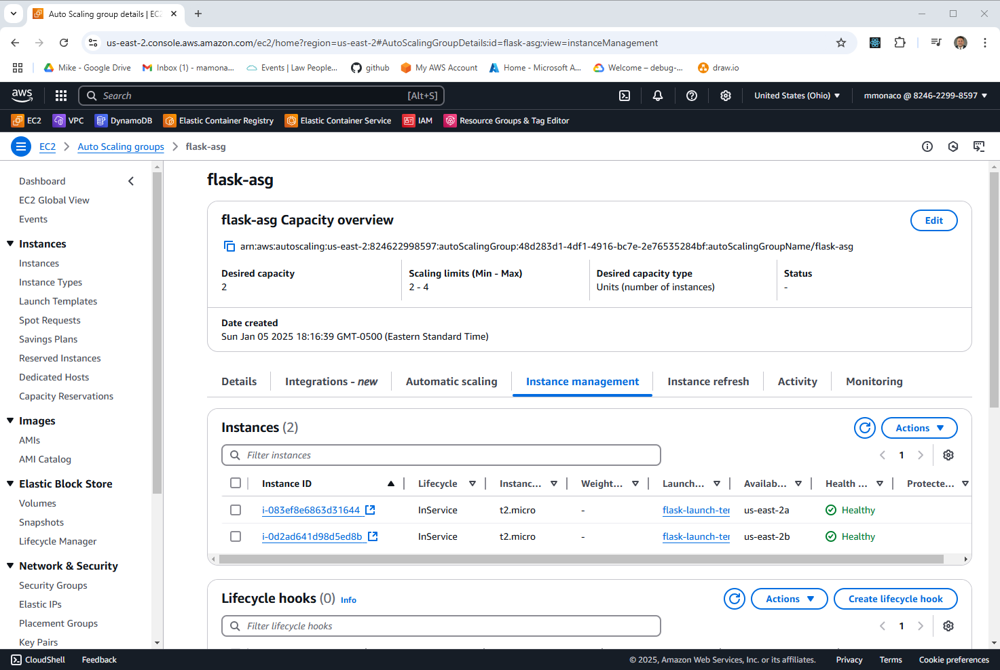
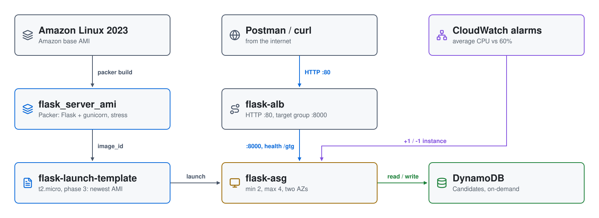

# Flask Microservice on an AWS Auto Scaling Group

Part 1 of the series
[Scaling in the Cloud: AWS Auto Scaling, Azure VMSS, and GCP MIGs](https://youtu.be/fogz73FXJEA).
A small Flask service that stores candidates in **DynamoDB** is baked into an
AMI with **Packer**, then run behind an **Application Load Balancer** in an
**Auto Scaling group** that adds and removes instances on CPU load.



| Piece | Where | Role |
|---|---|---|
| **flask_server_ami** | your account | Amazon Linux 2023 + the Flask app under gunicorn (systemd), `stress` for load tests |
| **flask-launch-template** | us-east-2 | `t2.micro` from the AMI; security groups for 443 and 8000 |
| **flask-asg** | `flask-subnet-1` / `-2` (us-east-2a, us-east-2b) | 2 to 4 instances; ELB health checks |
| **flask-alb** | both subnets | internet-facing, HTTP 80, forwarding to target group `flask-alb-tg` on 8000; health check `/gtg` |
| **CloudWatch alarms** | regional | `HighCPUUtilization` and `LowCPUUtilization` driving the scale-up and scale-down policies |
| **DynamoDB** | regional | `Candidates` table, on-demand, keyed on `CandidateName` |

## Architecture

<picture>
  <source media="(prefers-color-scheme: dark)" srcset="architecture-dark.svg">
  
</picture>

Regenerate with `python3 make_diagram.py`.

- **`01-infrastructure/`**: the VPC (`flask-vpc`, 10.0.0.0/24) with two
  public subnets, the security groups, the ALB, the launch template, the
  Auto Scaling group and its alarms and policies, the DynamoDB table, and the
  instance role (DynamoDB `Query`, `PutItem`, `Scan` plus SSM).
- **`02-packer/`**: `flask_ami.pkr.hcl`, `install.sh`, and the app in
  `scripts/` (`app.py`, the systemd unit, `requirements.txt`, and the
  `test_candidates.py` smoke test).
- **`build/`**: the per-phase scripts `apply.sh` and `destroy.sh` call, in
  Bash and PowerShell.

## How it builds

1. **Phase 1**: Terraform builds everything with a placeholder AMI and an
   Auto Scaling group of 0.
2. **Phase 2**: Packer builds `flask_server_ami_<timestamp>` in the new VPC.
3. **Phase 3**: Terraform finds the newest `flask_server_ami*`, puts it in the
   launch template, and sets the group to 2.

## How it scales

| Policy | Alarm | Action |
|---|---|---|
| Scale up | average CPU **above 60%** for 2 periods of 30 s (1 minute) | add 1 instance, 120 s cooldown |
| Scale down | average CPU **below 60%** for 10 periods of 30 s (5 minutes) | remove 1 instance, 120 s cooldown |

Scale-up reacts fast and scale-down slowly, so a brief dip doesn't remove
capacity. New instances get a 60-second warm-up, and the group stays
between 2 and 4.

## API

| Method | Path | Returns |
|---|---|---|
| GET | `/gtg` | 200; with `?details=true`, `{"connected": "true", "instance-id": ...}` |
| GET | `/candidate/<name>` | the candidate, or 404 |
| POST | `/candidate/<name>` | `{"CandidateName": <name>}`, or 500 |
| GET | `/candidates` | every candidate, or 404 |

## Security groups

```
internet ─80─▶ flask-alb ─8000─▶ flask-asg instances
```

`flask-sg-http` (80) is on the ALB; `flask-sg-https` (443) and
`flask-sg-flask` (8000) are on the instances. All allow `0.0.0.0/0`. The
instances have no SSH key or SSH rule; reach them through **SSM Session
Manager**.

## Prerequisites

* [An AWS Account](https://aws.amazon.com/console/)
* [Install AWS CLI](https://docs.aws.amazon.com/cli/latest/userguide/getting-started-install.html)
* [Install Terraform](https://developer.hashicorp.com/terraform/install)
* [Install Packer](https://developer.hashicorp.com/packer/install)

If this is your first time watching our content, we recommend starting with
this video: [AWS + Terraform: Easy Setup](https://youtu.be/BCMQo0CB9wk).

## Deploy

```bash
git clone https://github.com/mamonaco1973/aws-flask-asg.git
cd aws-flask-asg
./apply.sh       # or .\apply.ps1
```

Everything deploys to `us-east-2`. `apply.sh` ends by running
`validate.sh`, which waits for healthy targets in `flask-alb-tg` and runs
the smoke test against the ALB:

```
NOTE: Healthy targets found on flask-alb-tg.
NOTE: Testing the EC2 Solution
NOTE: URL for EC2 Solution is http://flask-alb-1234567890.us-east-2.elb.amazonaws.com/gtg?details=true
✓ good to go passed
✓ insert passed
✓ verification passed
✓ candidate list passed
```

## Try it

1. Open the `/gtg?details=true` URL in Postman (or `curl`) a few times: the
   `instance-id` changes as the ALB spreads requests.

   

2. Load the group: open a session on an instance with
   `aws ssm start-session --target <instance-id>` and run
   `stress --cpu 2 --timeout 600`. Within a couple of minutes the group adds
   an instance; about five minutes after the load stops, it removes one.

## Teardown

```bash
./destroy.sh     # or .\destroy.ps1: deregisters the AMIs and deletes their snapshots, then destroys the infrastructure
```

## Notes

- **Lab only.** The ALB and instances are open to the internet over plain
  HTTP.
- `01-infrastructure/keys/` holds an SSH key pair committed to this public
  repository; the launch template doesn't use it (`key_name` is commented
  out), but don't reuse that key.
